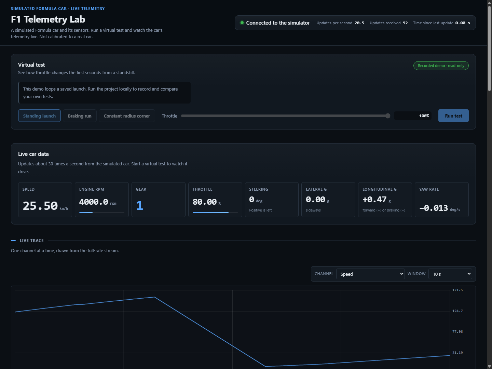

# F1 Telemetry Lab

A Python/TypeScript telemetry platform using a simulated Formula car. Run an
experiment, inspect its traces, save the complete run to Parquet, restart the
server, and replay or compare recorded results.

The car is **synthetic and uncalibrated**. This project demonstrates telemetry
contracts, asynchronous delivery, reproducible recording/replay and diagnostics.
It does not predict a real F1 car's performance.



[Short demo](docs/assets/demo.webm) · [Architecture](docs/architecture.md) ·
[Measured performance](docs/performance.md) · [Case study](docs/case-study.md)

## Run it

Requires Python 3.12 with uv, and Node.js 22.12 or newer with npm.
From a checkout, install the locked dependencies and build the dashboard:

```powershell
uv sync --frozen
npm ci --prefix web
npm run build --prefix web
uv run f1-serve --web-root web/dist
```

Open <http://localhost:8765>. Choose a standing launch, braking run or
constant-radius corner, adjust its setting, then press **Run test**. The server
computes and saves the scenario before playing its samples at wall-clock pace.
Completed recordings appear under **Saved tests**. They remain available after
a page refresh or server restart. Replay a selected test, or choose two runs of
the same scenario and compare their results.

For the included read-only looping recording, run `uv run f1-demo` instead.
Docker offers both the read-only demo (`docker compose up --build`) and the
interactive lab (`docker compose --profile lab up --build lab`). See [the demo guide](docs/demo.md)
for ports, persistent recordings, security boundaries and browser checks.

## Engineering

- **One channel contract:** channels.yaml generates Python registries, Arrow schema
  definitions and TypeScript metadata. CI checks drift, idempotence and a rate edit
  all the way to Chrome.
- **Deterministic simulation:** fixed-step NumPy/Numba physics, bounded scenarios,
  numerical invariants and golden regression traces.
- **Bounded streaming:** original timestamped samples are batched behind a lower-rate
  snapshot. Each viewer has bounded output; stalled viewers are disconnected rather
  than allowed to block healthy viewers or silently lose samples/events.
- **Durable runs:** immutable Parquet files include summaries, configuration
  snapshots/hashes, settings and available code provenance. Replay reads recorded
  samples rather than rerunning physics.
- **Diagnostics:** validity checks, reduced-order residuals, multivariate scoring
  and persistence. [Synthetic evaluation](docs/detection.md) discloses failures.
- **Sensor/bus pipeline:** contract-driven quantisation, seeded noise, fault
  injection, CAN-FD scheduling/framing and annotation-aware replay.

Physics integration, retained scenario samples, sensor sampling, network delivery
and UI refresh use different rates. The lab retains 100 Hz scenario frames and
normally delivers batches at up to 30 Hz. The noise-source demonstration separately
exercises per-channel contract rates. See [clock boundaries](docs/architecture.md#rates-and-clocks).

## Operating it

Recordings default to the ignored runs/ directory; use `--runs-dir PATH` to choose
another server-owned directory. Back it up if needed. A corrupt recording produces
an explicit error naming the run; it is never silently ignored. One server has
one shared car, so attempts to replace active computation/playback are rejected.

`/healthz` reports readiness, source state, connected viewers, delivery counters,
send failures and slow-viewer disconnections. Local binding and browser-origin
checks remain the default. Public demonstration mode requires explicit read-only
configuration and allowed origins; see the [deployment guide](docs/demo.md).

For development, run `uv run f1-serve` and `npm --prefix web run dev` in separate
terminals. `--noise` selects contract-rate test data; `--replay-parquet PATH`
serves a finite recording. VITE_TELEMETRY_WS_URL overrides the socket URL; a built
dashboard otherwise uses its own origin.

## Verification

```powershell
uv run ruff check src tests
uv run ruff format --check src tests
uv run basedpyright
uv run f1-check-contract
uv run pytest
node --test web/tests/telemetry.test.mjs
npm run build --prefix web
```

[Release evidence](docs/release-checklist.md) records checks actually performed.
[The demo guide](docs/demo.md) contains the browser workflow command.

## Project layout

| Path | Purpose |
| --- | --- |
| [`src/f1telemetry/`](src/f1telemetry/) | Simulator, telemetry pipeline, server and analytics |
| [`web/`](web/) | React dashboard and browser checks |
| [`tests/`](tests/) | Python tests, regression traces and container check |
| [`docs/`](docs/) | Architecture, calibration, measured results and research roadmap |
| [`tracks/`](tracks/) | Track definitions and attributed source data |
| [`examples/`](examples/) | Recording used by the read-only demo |
| [`channels.yaml`](channels.yaml), [`car_spec.yaml`](car_spec.yaml) | Sensor contract and synthetic vehicle configuration |

The root also contains Python and Docker configuration, dependency lockfiles,
and license notices.

## Limits

[Calibration notes](docs/calibration.md) account for coefficient provenance and
open physical-validation gates. Aero, tyre, thermal and powertrain parameters
remain synthetic; brake torque is caller supplied rather than constrained by a
validated brake-capacity model. Short synthetic detection records do not establish
a real-world false-alarm rate. The dashboard streams precomputed scenarios and
is not an interactive driving simulator.

[The research roadmap](docs/roadmap/PLAN.md) and [phase reports](docs/roadmap/PHASES.md)
preserve historical plans; not every research phase is complete. This release has its own
[scope](docs/roadmap/release/specs/2026-11-03-portfolio-release-design.md).

Original project code is [Apache-2.0](LICENSE). Track data retains its original
license and attribution; see [third-party notices](THIRD_PARTY_NOTICES.md).
