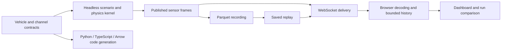

# Architecture

The system has one shared simulated car per server. A dashboard is a viewer and,
in local interactive mode, can request one of three bounded experiments.

`channels.yaml` owns channel names, units, sampling rates, ranges and sensor
metadata. Code generation produces the registries and schema definitions used
by consumers. CI checks drift and a contract rate edit through to the browser.
`car_spec.yaml` owns numerical coefficients and their provenance.

## Rates and clocks

| Boundary | Clock/rate | Meaning |
|---|---|---|
| Physics integration | Fixed `integration.dt_s = 0.0001` s | Numerical simulation steps, equivalent to 10 kHz in simulation time |
| Headless scenario publication | Current scenario frames are decimated to 100 Hz | Samples retained by the dashboard scenario path |
| Sensor pipeline | Per-channel rates in `channels.yaml` | Separate contract-driven processing and CAN-FD scheduling |
| WebSocket | Default maximum 30 delivery frames/s | A delivery may contain several original timestamped samples |
| Dashboard | Latest-value updates plus per-sample history | Display work is throttled independently of sample retention |

These are different rates. The noise-source contract-rate demonstration and the
scenario playback demonstration exercise different sources. A 10 kHz integration
step is not a claim of 10,000 live network messages or physical sensor samples/s.

Simulation timestamps are deterministic integer microseconds on the wire. The
server uses a monotonic wall clock for pacing; the browser uses its own monotonic
clock for arrival/display diagnostics. Never subtract those independent clocks
to claim network latency. Performance measurements must describe their own timing
boundary and clock relationship.

## Boundaries worth preserving

- The physics core produces truth and published measurements separately. Analytics
  consume published measurements without importing the physics core.
- Scenario requests have a fixed schema, allowed scenarios and bounded finite settings.
- Parquet replay reads recorded values and timestamps; it does not rerun physics.
- Original samples travel in batches behind a lower-rate snapshot, so UI refresh
  throttling does not silently discard the source's retained samples.
- The local server's loopback and browser-origin policy is a trust boundary.
  Public demonstration mode must be explicitly read-only.

See [calibration limits](calibration.md) for the distinction between numerical
correctness and agreement with a real vehicle.
