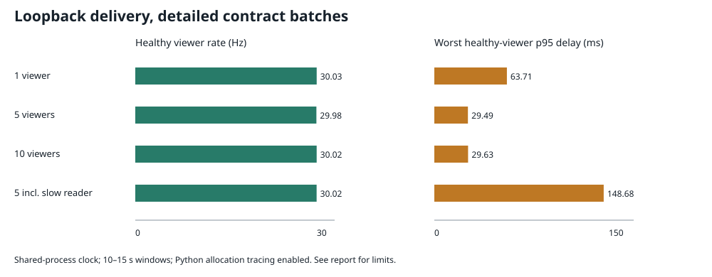

# Measured telemetry delivery

Measured 2026-11-03 on an Intel Core Ultra 9 185H (16 cores / 22 logical processors),
Windows, approximately 31.4 GiB RAM, Python 3.12.11. These are single-run baseline
observations on a shared workstation, not capacity limits or latency guarantees.
The full Python suite and container work were active during collection.



## Results

Delay is the worst per-viewer p95 among healthy readers, not a pooled or averaged
percentile. Slow-reader measurements remain visible in the raw data.

| Workload | Actual window (s) | Healthy rate (Hz) | Worst healthy p95 (ms) | Process CPU (s) | Peak traced Python (MiB) | Raw data |
|---|---:|---:|---:|---:|---:|---|
| 1 viewer | 10.007 | 30.03–30.03 | 63.71 | 4.609 | 0.185 | [JSON](benchmarks/benchmark-1.json) |
| 5 viewers | 9.987 | 29.98–30.00 | 29.49 | 4.500 | 0.479 | [JSON](benchmarks/benchmark-5.json) |
| 10 viewers | 10.005 | 30.02–30.03 | 29.63 | 4.672 | 0.870 | [JSON](benchmarks/benchmark-10.json) |
| 5 incl. slow reader | 15.015 | 30.02–30.02 | 148.68 | 5.438 | 1.026 | [JSON](benchmarks/benchmark-slow.json) |

Each healthy detailed reader received approximately 300 KiB/s of application JSON.
This excludes TCP/WebSocket/TLS framing. Average cadence stayed near the 30 Hz
target; tail delay makes clear that this is not a hard real-time guarantee.
Non-monotonic results do not prove that adding clients improves latency.

The slow workload pauses reader 0 for 0.5 seconds after each receive. Its reads
lagged by seconds while the other four readers continued near 30 Hz. No close was
observed by the slow reader within the window: buffered TCP/library data may
outlast measurement. This case does not prove an overflow disconnect; controlled
blocked-send/overflow tests independently prove bounded queues and isolation.

## Measurement boundaries

- Source: seeded uniform contract noise. No physics integration or Numba compilation.
- Server and load clients share one Python process and perf_counter_ns. A benchmark
  marker is inserted before JSON encoding; delay ends after recv, before JSON decode.
  It includes encoding, queueing and loopback scheduling, but excludes source sampling,
  initial wire-dictionary construction, browser decoding and display paint.
- This is loopback, not internet one-way latency. Independent machines would require
  a synchronized clock or a round-trip measurement.
- CPU covers both server and load clients. Memory is peak traced Python allocations,
  including driver/measurement arrays; it excludes native allocations and is not RSS
  or server-only steady-state usage. Allocation tracing itself adds overhead.
- Driver JSON decoding is sequential on the shared loop, so client-index differences
  include that work. OS timer resolution may slightly shorten/extend requested windows;
  bandwidth divides by actual measured duration.
- Raw JSON records source revision/runtime/workload and individual readers. Revisions
  4125095 and 4991f1b contain the measured benchmark code; their difference is CI and
  packaging. Uncommitted documentation/user edits were present.

## Reproduce

```powershell
uv run f1-benchmark --duration 10 --clients 1 --detailed --output reports/benchmark-1.json
uv run f1-benchmark --duration 10 --clients 5 --detailed --output reports/benchmark-5.json
uv run f1-benchmark --duration 10 --clients 10 --detailed --output reports/benchmark-10.json
uv run f1-benchmark --duration 15 --clients 5 --detailed --slow-delay 0.5 --output reports/benchmark-slow.json
```

Run cases sequentially. Use a longer window on an otherwise idle machine before
setting a service budget, recording those conditions with the new raw output.

The older [latency/bundle notes](latency.md) preserve earlier microbenchmarks;
they are not this report’s end-to-end delivery measurement.
